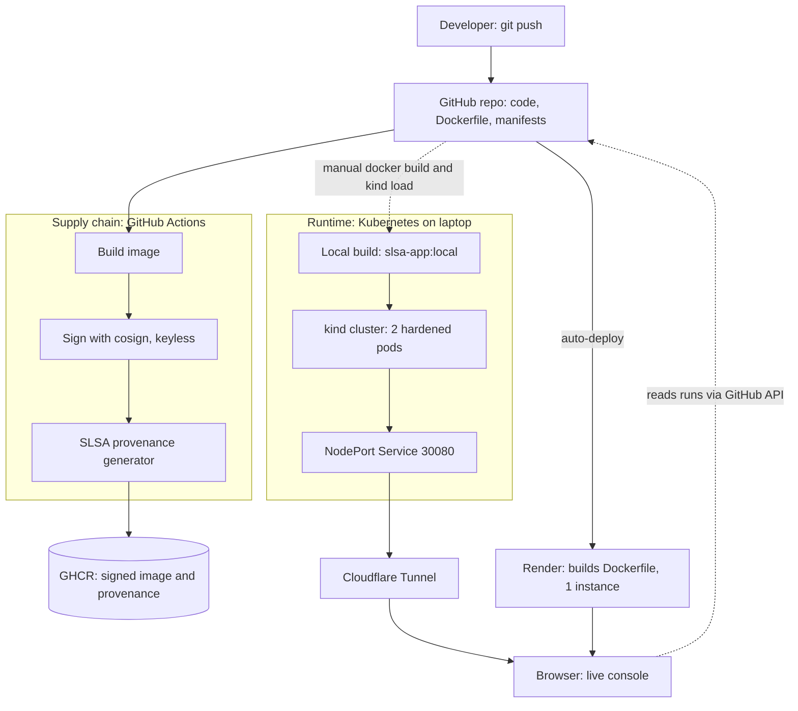

# SLSA-Attested, Hardened Kubernetes Workload

A small Flask service packaged as a shell-less, non-root container, deployed to Kubernetes with a locked-down `securityContext`, and built by a CI pipeline that signs the image and generates SLSA provenance. A built-in live console lets you attack the running container and watch Kubernetes recover from failures.

## Live demo

| Link | What it runs | Availability |
|---|---|---|
| Cloudflare quick-tunnel URL (shared during live demos) | The real 2-replica Kubernetes cluster (kind) on the author's laptop | Only while the laptop and tunnel are running. The URL changes each time the tunnel restarts |
| https://slsa-attestation-pipeline.onrender.com | The same source and Dockerfile, built and run by Render as a single instance | Always on, but sleeps after 15 minutes idle; the first request can take 30 to 60 seconds |

Both links serve the same application code, but they are separate builds on different runtimes, so the security results differ. That difference is intentional and is explained below.

## Architecture



### The three paths

| Path | Triggered by | What it builds | Where it ends up |
|---|---|---|---|
| Supply chain (GitHub Actions) | Push to `main` | The Dockerfile, in CI | Signed image and SLSA provenance in GHCR |
| Runtime (kind on a laptop) | Manual `docker build` and `kind load` | The Dockerfile, locally, as `slsa-app:local` | 2 pods under the hardened manifest |
| Render | Push to `main` (auto-deploy) | The Dockerfile, on Render | 1 instance with Render's own runtime settings |

### Where each protection comes from

| Protection | Defined in | Applies on Render? |
|---|---|---|
| Non-root user (UID 10001) | `Dockerfile` | Yes |
| No shell, `curl` or `wget` | `Dockerfile` | Yes |
| Read-only root filesystem | `deployment.yaml` | No |
| All capabilities dropped | `deployment.yaml` | No |
| `allowPrivilegeEscalation: false` | `deployment.yaml` | Partly (Render's defaults) |
| Seccomp profile | `deployment.yaml` | No |
| 2 replicas, probes, self-healing | `deployment.yaml` | No |

A Docker image can only define what is inside it and some startup defaults. Runtime restrictions such as a read-only filesystem, capability drops and seccomp are decided by whoever runs the container. That is why the Kubernetes manifest is a separate layer, and why Render, which runs the image with its own settings, does not show them.

### Build identity

The three paths are separate builds of the same source and Dockerfile. They are equivalent in intent but not guaranteed to be byte-identical, because base images, transitive dependencies and file timestamps can differ between builds. Nothing currently pulls the signed GHCR image into either runtime. See [Known limitations](#known-limitations).

## Tech stack

| Layer | Technology |
|---|---|
| Application | Python 3.11, Flask 3.0.3, Werkzeug, python-json-logger |
| Console UI | Plain HTML, CSS and JavaScript, served by Flask |
| Container | Docker, multi-stage build on `python:3.11-slim`, shells removed, UID 10001 |
| Orchestration | Kubernetes (kind locally), `kubectl`, Deployment and NodePort Service |
| CI/CD | GitHub Actions |
| Supply chain | Sigstore cosign (keyless OIDC signing), `slsa-github-generator` (SLSA provenance), GHCR |
| Public access | Cloudflare Tunnel (`cloudflared`) and Render |
| Live data | GitHub REST API (workflow runs and jobs) |

## How to test it

Open either link. Every result on the page comes from the running container or from the GitHub API at the moment you click. Nothing is pre-loaded.

1. **Who answered this request.** The page polls `/api/whoami` every second. On the cluster link, watch two pod names appear with their own request counters. That is the Kubernetes Service balancing requests across replicas.
2. **Attack the running container.** Press **Run all five**, or press each button on its own. The container really attempts each action and reports the result:
   - *Spawn a shell*: tries to execute `sh`, `bash`, `dash` and `rbash`.
   - *Find download tools*: looks for `curl` and `wget`.
   - *Write to filesystem*: tries to create a file in `/etc`, `/app` and `/tmp`.
   - *Escalate to root*: calls `setuid(0)` and tries to read `/etc/shadow`.
   - *Inspect privileges*: reads `/proc/self/status` for the UID, capability sets, `NoNewPrivs` and seccomp mode.
3. **Self-healing.**
   - *Crash the pod serving me* makes the process exit. Kubernetes restarts the container while the other replica keeps answering, and the timeline records the failure and the recovery.
   - *Copy kubectl delete command* copies `kubectl delete pod <name>` for the pod currently serving you. Run it in a terminal and watch the page stay up while a replacement pod starts.
4. **Supply chain.** The page fetches the latest GitHub Actions runs and the jobs of the newest run (signing and SLSA provenance) directly from the GitHub API.

Each attack also writes a JSON log line. To see them on the cluster:

```
kubectl logs -l app=secure-api --tail=20
```

### Expected results

| Check | Kubernetes cluster | Render |
|---|---|---|
| Spawn a shell | blocked | blocked |
| Find download tools | blocked | blocked |
| Escalate to root | blocked | blocked |
| Inspect privileges | uid 10001, `CapEff=0`, `CapBnd=0`, `NoNewPrivs=1`, `Seccomp=2` | uid 10001, `CapEff=0`, `NoNewPrivs=1`, non-empty `CapBnd`, `Seccomp=0` |
| Write to filesystem | blocked in `/etc`, `/app` and `/tmp` (read-only file system) | `/etc` denied, `/app` and `/tmp` writable |
| Pods shown | 2 | 1 |

If a test ever shows "NOT blocked", that is a genuine finding about the environment, because the tests report what actually happened.

## How it works

### Container (`Dockerfile`)

- Multi-stage build on `python:3.11-slim`. Dependencies are installed in a builder stage, and the runtime stage contains only the app and its packages.
- Runs as unprivileged UID/GID `10001`.
- Removes `sh`, `bash`, `dash`, `rbash`, `curl` and `wget` from the runtime image.
- Note: this is a slim image with shells removed, not a distroless image.

### Kubernetes (`deployment.yaml`)

| Setting | Purpose |
|---|---|
| `runAsNonRoot`, `runAsUser/Group: 10001` | No root inside the container |
| `allowPrivilegeEscalation: false` | Sets `no_new_privs`, so child processes cannot gain rights |
| `readOnlyRootFilesystem: true` | Blocks file injection and runtime mutation |
| `capabilities.drop: ["ALL"]` | Removes all Linux capabilities |
| `seccompProfile: RuntimeDefault` | Filters dangerous system calls |
| `automountServiceAccountToken: false` | The pod gets no Kubernetes API credentials |
| Resource requests and limits | Bounds CPU and memory |
| 2 replicas, liveness and readiness probes on `/health` | Availability and self-healing |
| NodePort Service on 30080 | Load-balanced access to the pods |

### Live console (`app/app.py`, `app/static/index.html`)

| Endpoint | Purpose |
|---|---|
| `GET /` | The console page |
| `GET /health` | Probe endpoint |
| `GET /api/whoami` | Pod name, UID, uptime, requests served, image reference |
| `POST /api/attack/<name>` | Runs one of the five attack tests and returns the real outcome |
| `POST /api/chaos/crash` | Exits the process so you can watch recovery |

Responses send `Connection: close`, so each request opens a new connection and the Service balances it across pods.

### CI pipeline (`.github/workflows/`)

1. Builds the image and pushes it to GitHub Container Registry.
2. Signs the image digest with Sigstore cosign using keyless OIDC identity.
3. Calls the `slsa-github-generator` container workflow to produce SLSA provenance for the same digest.

## Verifying the signed image

The image is signed with Sigstore cosign using keyless OIDC identity. No long-lived signing keys exist. The signature is bound to the GitHub Actions workflow identity and recorded in the Rekor public transparency log.

### What you need

- [cosign](https://github.com/sigstore/cosign/releases) v2.x

**Windows (PowerShell):**
```powershell
Invoke-WebRequest -Uri "https://github.com/sigstore/cosign/releases/download/v2.2.4/cosign-windows-amd64.exe" -OutFile "cosign.exe"
```

**Linux / macOS:**
```bash
brew install cosign
# or
curl -Lo cosign https://github.com/sigstore/cosign/releases/download/v2.2.4/cosign-linux-amd64
chmod +x cosign && sudo mv cosign /usr/local/bin/
```

### Step 1 — Find the digest of the image you want to verify

The digest for each build is printed in the GitHub Actions run log under the **Build and Publish Hardened Container Image Digest** step. It looks like:

```
sha256:4c91eb802e1439b1ac3bba06fd9c19ac0612ccbdb72446e69e38c9bc04199d0f
```

You can also retrieve it locally after pulling the image:

**Windows (PowerShell):**
```powershell
docker pull ghcr.io/anubhav852/slsa-attestation-pipeline:sha256-80d44bbbac0ccfe51d64c6c63a42cc373d74fa5a
docker inspect --format='{{index .RepoDigests 0}}' ghcr.io/anubhav852/slsa-attestation-pipeline:sha256-80d44bbbac0ccfe51d64c6c63a42cc373d74fa5a
```

**Linux / macOS:**
```bash
docker pull ghcr.io/anubhav852/slsa-attestation-pipeline:sha256-80d44bbbac0ccfe51d64c6c63a42cc373d74fa5a
docker inspect --format='{{index .RepoDigests 0}}' ghcr.io/anubhav852/slsa-attestation-pipeline:sha256-80d44bbbac0ccfe51d64c6c63a42cc373d74fa5a
```

### Step 2 — Verify the cosign signature

**Windows (PowerShell):**
```powershell
& "cosign.exe" verify `
  ghcr.io/anubhav852/slsa-attestation-pipeline@sha256:4c91eb802e1439b1ac3bba06fd9c19ac0612ccbdb72446e69e38c9bc04199d0f `
  --certificate-identity-regexp "^https://github.com/Anubhav852/slsa-attestation-pipeline/" `
  --certificate-oidc-issuer https://token.actions.githubusercontent.com
```

**Linux / macOS:**
```bash
cosign verify \
  ghcr.io/anubhav852/slsa-attestation-pipeline@sha256:4c91eb802e1439b1ac3bba06fd9c19ac0612ccbdb72446e69e38c9bc04199d0f \
  --certificate-identity-regexp "^https://github.com/Anubhav852/slsa-attestation-pipeline/" \
  --certificate-oidc-issuer https://token.actions.githubusercontent.com
```

### Step 3 — What a successful result looks like

```
Verification for ghcr.io/anubhav852/slsa-attestation-pipeline@sha256:4c91eb802e1439b1ac3bba06fd9c19ac0612ccbdb72446e69e38c9bc04199d0f --
The following checks were performed on each of these signatures:
  - The cosign claims were validated
  - Existence of the claims in the transparency log was verified offline
  - The code-signing certificate was verified using trusted certificate authority certificates

[{"critical":{"identity":{"docker-reference":"ghcr.io/anubhav852/slsa-attestation-pipeline"},...
```

### What the certificate confirms

| Field | Value |
|---|---|
| Signer | `Anubhav852/slsa-attestation-pipeline/.github/workflows/build-and-sign.yml` |
| OIDC issuer | `https://token.actions.githubusercontent.com` |
| Trigger | `push` |
| Branch | `refs/heads/main` |
| Commit | `80d44bbbac0ccfe51d64c6c63a42cc373d74fa5a` |
| Transparency log | Rekor (log index `3557533133`) |

This proves the image was built and signed exclusively by the GitHub Actions workflow using keyless OIDC — no static secrets or long-lived keys were used at any point.

### Verifying a different commit

Each push to `main` produces a new image tagged as `sha256-<full-commit-sha>`. To verify any historical build:

1. Find the full commit SHA: `git log --oneline`
2. Pull the image: `docker pull ghcr.io/anubhav852/slsa-attestation-pipeline:sha256-<full-commit-sha>`
3. Get its digest from the pull output (`Digest: sha256:...`)
4. Run the cosign verify command above with that digest

## Run it locally

Prerequisites: Docker Desktop, `kubectl`, and `kind`.

```
git clone https://github.com/Anubhav852/slsa-attestation-pipeline
cd slsa-attestation-pipeline
kind create cluster --config kind-config.yaml
docker build -t slsa-app:local .
kind load docker-image slsa-app:local
kubectl apply -f deployment.yaml
kubectl get pods
```

When both pods are `1/1 Running`, open http://localhost:30080.

After changing code, rebuild and reload the image, then restart the pods:

```
docker build -t slsa-app:local .
kind load docker-image slsa-app:local
kubectl rollout restart deployment slsa-hardened-app
```

To expose the local cluster publicly with a temporary Cloudflare quick tunnel:

```
cloudflared tunnel --url http://localhost:30080
```

## Known limitations

- **The signed image is not what runs.** CI signs and attests the image in GHCR, but nothing pulls it. The cluster runs a locally built `slsa-app:local`, and Render builds its own copy. The console labels the cluster image as tag-only, not digest-pinned.
- **The builds are not provably identical.** The base image tag, transitive Python dependencies and file timestamps can differ between builds.
- The Flask built-in server keeps the container write-free for the read-only filesystem demo. A production deployment would use a dedicated WSGI server with an `emptyDir` volume for temporary files.
- The crash endpoint is unauthenticated by design for the demo. Do not expose it on a production service.
- The Cloudflare quick tunnel has no uptime guarantee, and its URL changes each time it restarts.

## Roadmap

1. Pin the base image by digest and add a dependency lock file for reproducible builds.
2. Verify the GHCR image with `cosign` and `slsa-verifier`, then deploy it by digest.
3. Add an admission policy that rejects unsigned images.
4. Move the manifest to a managed Kubernetes cluster for a permanent public deployment.